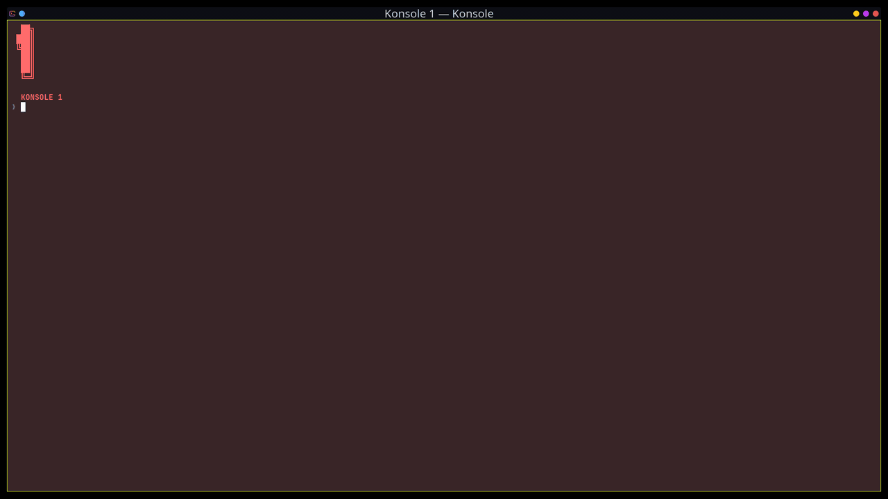

# Kröhnkite

[Documentation](https://codeberg.org/anametologin/Krohnkite/wiki) | [Tips](https://codeberg.org/anametologin/Krohnkite/wiki/Tips)

Author of [Kröhnkite](https://github.com/esjeon/krohnkite). A dynamic tiling extension for KWin 6 only.
Kröhnkite is mainly inspired by [dwm][] from suckless folks, and aims to
provide rock solid stability while fully integrating into KWin.

The name of the script is from mineral [Kröhnkite][wikipedia]; it starts with
K and looks cool.

[dwm]: https://dwm.suckless.org/
[wikipedia]: https://en.wikipedia.org/wiki/Kr%C3%B6hnkite



## Features

- DWM-like window tiling
  - Dynamically tile windows, rather than manually placing each
  - Floating windows
- Fully integrates into KWin features, including:
  - **Multi-screen**
  - **Activities & Virtual desktop**
  - Basic window management (minimize, fullscreen, switching, etc.)
- Multiple Layout Support
  - Tiling layout
  - Monocle layout
  - Desktop-friendly layouts (Spread, Stair)

## Development Requirements

- Typescript (see package.json)
- [go-task](https://github.com/go-task/task)
- p7zip (7z)
- python3 (reload helper and its tests)

`go-task reload`, `go-task reload-file`, and the development autoinstall daemon
(`tools/autoinstall`) also need a running KWin session with `qdbus6` reachable on
the session bus; nothing else in the project uses it.

Run the automated tests with `go-task test` (or `npm run check`). The reload
helper tests use an isolated fake `qdbus6`; they do not contact KWin.

## Look at me
### Reload Krohnkite configuration
&emsp;<b>Important:</b> After changing the configuration, simply clicking `Apply` is not enough, ask KWin to reload its configuration
   ```sh
   qdbus6 org.kde.KWin /KWin org.kde.KWin.reconfigure
   ```

### Apply code changes without logout

```sh
go-task reload
```

This builds, installs, and reloads Kröhnkite through KWin's scripting interface.
Every reload copies the complete bundle to a fresh cache directory, bypassing
cached QML and JavaScript, and starts the reloaded script through KWin's scripting
interface. KWin starts every script that is still pending at that point; a reload
leaves the reloaded script as the pending one. No logout or compositor restart is
required. The copied bundle stays available for lazy
resource loading, and superseded bundles are deleted. After each successful
reload, the helper records that bundle path under the cache directory. If a later
replacement is refused by KWin, it best-effort reloads the last known working
bundle; recovery is unavailable when no prior bundle is recorded or its files are
gone, and does not guarantee exact restoration. QML errors inside a bundle appear
in KWin's journal only, so a bundle that loads but fails to run is not rolled back.
For a command preview: `python3 tools/reload-script.py pkg --dry-run`.

A package that is already built or downloaded needs no rebuild:

```sh
go-task reload-file -- path/to/krohnkite-*.kwinscript
```

The helper accepts a build directory or a `.kwinscript` archive.

`go-task reload` and `go-task reload-file` are the paths that take effect without
a restart. A package installed or upgraded any other way - `go-task install` or
`kpackagetool6` - is picked up only after KWin starts again, so log out and back
in (or restart the compositor). The autoinstall daemon runs the same helper after
every successful install, but only when Krohnkite is already loaded; a package
installed by it while the script is not loaded is used on the next login.

### Enable Krohnkite
```
kwriteconfig6 --file kwinrc --group Plugins --key krohnkiteEnabled true && qdbus6 org.kde.KWin /KWin reconfigure
```
### Disable Krohnkite
```
kwriteconfig6 --file kwinrc --group Plugins --key krohnkiteEnabled false && qdbus6 org.kde.KWin /KWin reconfigure
```
### Troubleshooting

1. Delete unused KWin shortcuts. You can use any D-Bus program which can invoke D-Bus methods. Service name -`org.kde.kglobalaccel` path - `/component/kwin` method - `org.kde.kglobalaccel.Component.cleanUp`. Arch Linux example:

   ```sh
   qdbus6 org.kde.kglobalaccel /component/kwin org.kde.kglobalaccel.Component.cleanUp
   ```

2. If you have a gap or you have gray rectangle (or white, etc.), that means that there is a program with size 1x1 that has to be filtered by title or other ways. Make sure that the following programs, if you have them, have been added to the filter:

   ```
   xwaylandvideobridge,plasmashell,ksplashqml
   ```

## Installation

You can install Kröhnkite in multiple ways.

### Using .kwinscript package file

You can download `krohnkite-x.x.x.x.kwinscript` file, and install it through
_System Settings_.

1. Download the kwinscript file
2. Open `System Settings` > `Window Management` > `KWin Scripts`
3. Press `Import KWin script...` on the top-right corner
4. Select the downloaded file

Alternatively, through command-line:
get info about package:

```
kpackagetool6 -t KWin/Script -s krohnkite
```

install:

```
kpackagetool6 -t KWin/Script -i krohnkite-x.x.x.x.kwinscript
```

upgrade:

```
kpackagetool6 -t KWin/Script -u krohnkite-x.x.x.x.kwinscript
```

uninstall:

```
kpackagetool6 -t KWin/Script -r krohnkite
```

### Installing from Git repository

Make sure you have [go-task](https://taskfile.dev/installation/), [npm](https://docs.npmjs.com/downloading-and-installing-node-js-and-npm), [7-zip](https://www.7-zip.org/download.html) and Python 3 packages installed. All packages after building will be in `builds` folder.
The simplest method to automatically build and install kwinscript package would be:

```
go-task install
```

The new code is used after the next login; use `go-task reload` to switch without
logging out.

You can also build `.kwinscript` package file using:

```
go-task package
```

uninstall package:

```
go-task uninstall
```

## Tests

Run the full test suite with `go-task test` (or `npm run check`). The layout
icon tests run against the real installer in isolated temporary XDG data
directories. The native Qt UI rendering check runs when PySide6 is installed
and otherwise reports an explicit skip. `npm test` runs only the layout icon
tests.

## Settings

### Add a class name, a resource name or a window caption to ignore or float

1. to find window's className, resourcename, or caption, see [readme](https://github.com/anametologin/krohnkite#search-a-window-parameters-to-filter-float-etc)
2. you can use the name of class in square brackets: `[myNamE]` will float or ignore all windows with class or resource names such: 'myname1', 'Myname2', 'Notmyname555' etc...

### Choose layout for screen by default

1. Open Krohnkite options: 
2. Tab `Rules->Screen default layout`. Layout configuration has format `OutputName:ActivityId:VirtualDesktopName:layoutName`.

Multi monitor example:

`HDMI-A-1:99a12h44-e9a6-1142-55eedaa7-3a922a15ab08::columns,DP-2:spread,DP-3:Desktop 3:tile,:threecolumn`

The result will be:

- set `columns` layout as default on monitor `HDMI-A-1`, only on activity with id:`99a12h44-e9a6-1142-55eedaa7-3a922a15ab08`, every virtual desktop on this activity. If you specify `activity id`, you have to specify the virtual desktop name or leave it blank;
- set `spreadlayout` layout as default on monitor `DP-2`, on every Activity, on every virtual desktop;
- set `tilelayout` layout as default on monitor `DP-3`, on every activity, only on virtual desktop with name `Desktop 3`;
- set `threecolumnlayout` layout as default on all monitors, all activities, and all virtual desktops not covered by the previous rules.

2. How to find `outputName`, `activityId`, `VirtualDesktopName`, `layoutName`: Right after system boot, run `KSystemLog`

   - Push ignore button
   - Type in filter string: `krohnkite`
   - Right after `KROHNKITE: starting the script` string you will see one if you have one monitor or multiple lines: Screen(output):`Screen Name`,Desktop(name):`Virtual Desktop Name`,Activity:`Activity Id`,layouts: `numbered layouts` (the case doesn't matter,`layout` ending can be omitted): `tilelayout`, `monoclelayout`, `columns`, `threecolumnlayout,` `spreadlayout`, `stairlayout`, `spirallayout`, `stackedlayout`, `floatinglayout`, `btreelayout`

3. Press `Apply`, then run
   `qdbus6 org.kde.KWin /KWin org.kde.KWin.reconfigure`.

### Search a window parameters to filter, float etc.

1. Krohnkite options: 
2. Options->Debug new Windows
3. Press `Apply`, then run `qdbus6 org.kde.KWin /KWin org.kde.KWin.reconfigure`
4. Run KSystemLog
5. Push `Ignore` button
6. Type in filter string: `krohnkite`
7. All created windows krohnkite working with will be there.
8. Every debug entry contains parameters except those that are false and empty.

## Icons

Kröhnkite ships its artwork as shared SVGs: layout pictograms in `res/layouts/`
and the application icon in `res/appicon/`. Install registers
`krohnkite-layout-*` under `$XDG_DATA_HOME/icons/hicolor/scalable/actions` and
`krohnkite.svg` under `$XDG_DATA_HOME/icons/hicolor/scalable/apps` (normally
`~/.local/share/icons`). `res/metadata.json` refers to the application icon by
its theme name, so KWin, System Settings and the KDE Store entry all use the
same artwork without any raster copy. Python 3 is required. `xdg-icon-resource`
refreshes the icon cache; if it is unavailable, the icons are still installed
and the refresh is retried on the next start.

Direct `.kwinscript` installs register the icons at KWin startup when the
optional `org.kde.plasma.plasma5support` QML module is available (some Plasma 6
systems ship it separately). Without that module the script still runs, KWin
logs a warning, and the icons are not installed automatically; run the
package's `contents/code/install-icons.py` manually, for example:

```
python3 ~/.local/share/kwin/scripts/krohnkite/contents/code/install-icons.py
```

Repository installs (`go-task install`) are not affected. Reopen settings after
installation. `go-task uninstall` removes only these icons.

The application icon is resolved by its theme name only: if it was never
installed, KWin shows a blank icon for the script instead of falling back to
another one. Running the installer once is enough to fix that.

## Useful Development Resources

- [KWin Scripting Tutorial](https://develop.kde.org/docs/plasma/kwin/)
- [KWin Scripting API](https://develop.kde.org/docs/plasma/kwin/api/)
- Adding configuration dialog
  - [Development/Tutorials/Plasma/JavaScript/ConfigDialog](https://techbase.kde.org/Development/Tutorials/Plasma/JavaScript/ConfigDialog)
  - [Development/Tutorials/Using KConfig XT](https://techbase.kde.org/Development/Tutorials/Using_KConfig_XT)
- `*.ui` files can be edited with [Qt Designer](http://doc.qt.io/qt-5/qtdesigner-manual.html).
  It's very straight-forward if you're used to UI programming.
